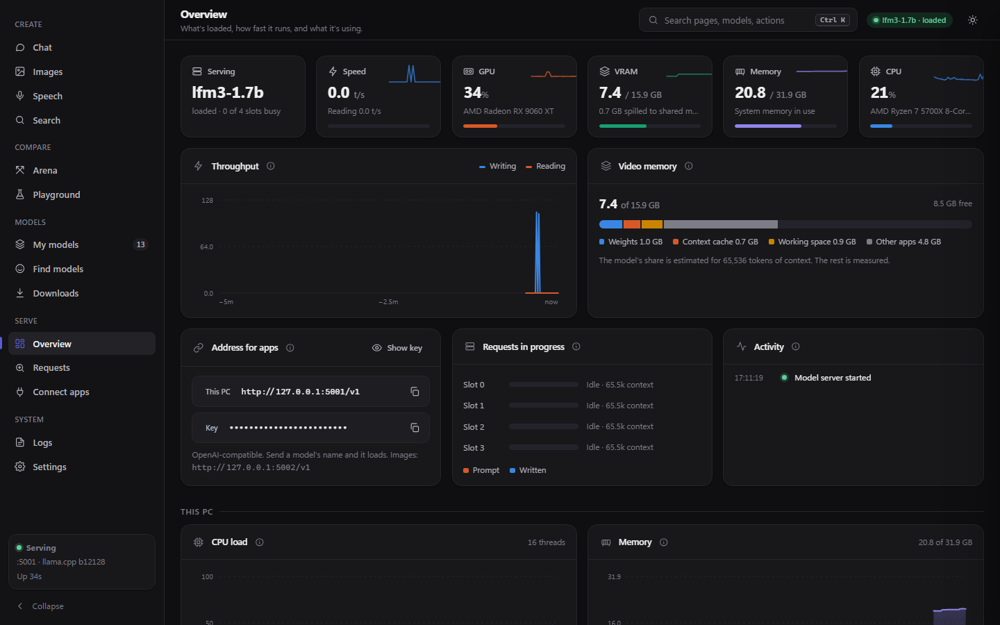
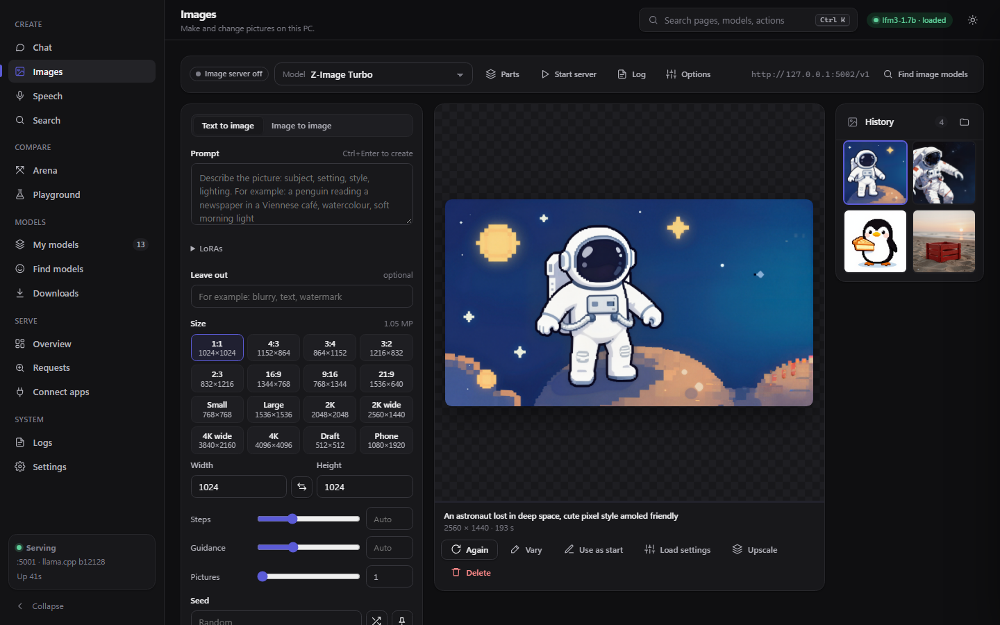
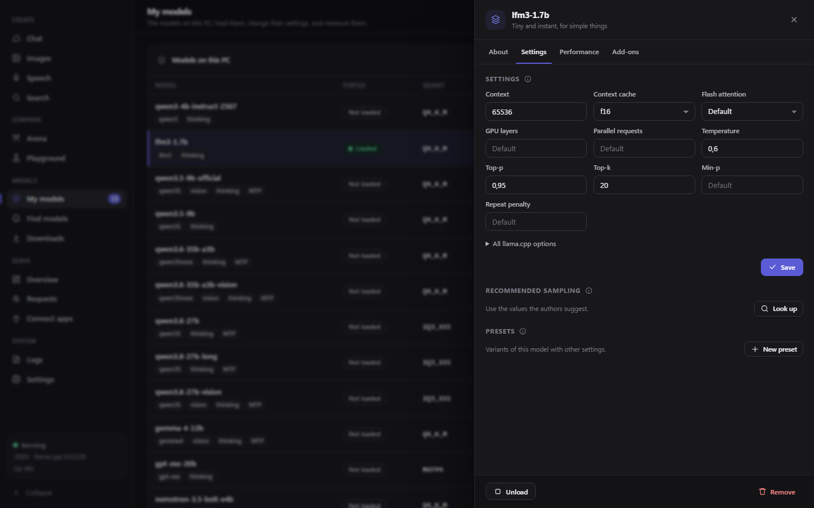
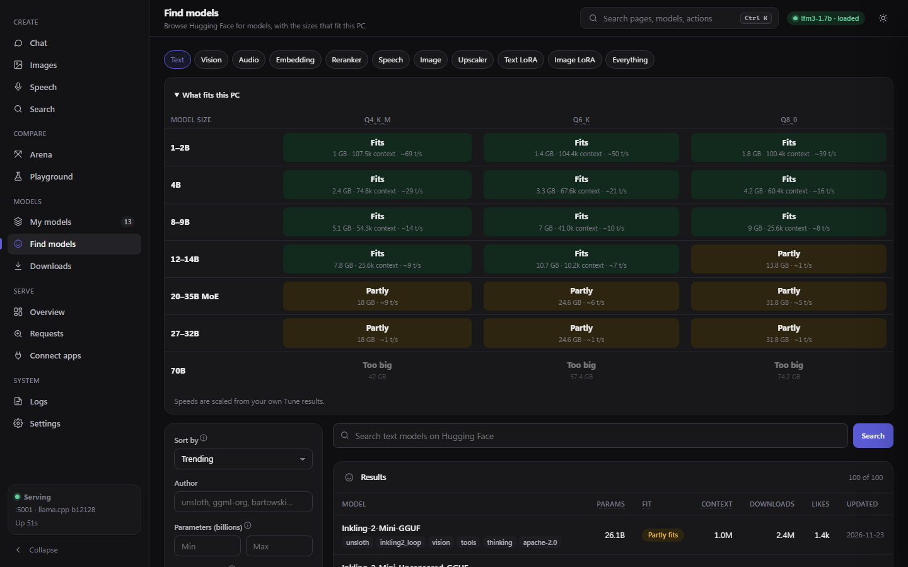

<p align="center">
  
</p>

<h1 align="center">Waddle</h1>

<p align="center">
  <b>The local AI sandbox.</b><br>
  Find a model, try it every way, see how it runs on your computer, then keep it running for every app you use.<br>
  One small program. Nothing you type, attach, or make leaves your computer.
</p>

<p align="center">
  <a href="https://github.com/soleritu/waddle/releases"></a>
  
  
  <a href="LICENSE.md"></a>
</p>

<p align="center"></p>

> **Beta.** 0.1 is the first public release. It works well on the machines it was built on; [tell us](https://github.com/soleritu/waddle/issues) what breaks on yours.

## Contents

- [Download](#download)
- [What it does](#what-it-does)
- [Your first ten minutes](#your-first-ten-minutes)
- [Use your models from other apps](#use-your-models-from-other-apps)
- [Run it in Docker](#run-it-in-docker)
- [Questions](#questions)
- [Build it yourself](#build-it-yourself)
- [License](#license)

The [user guide](docs/GUIDE.md) explains every page. The [design notes](docs/DESIGN.md) explain why Waddle works the way it does.

## Download

| System | Download | Or in a terminal |
|---|---|---|
| **Windows** 10 and 11 | [`Waddle-Setup.exe`](https://github.com/soleritu/waddle/releases) (no administrator rights needed) | `irm https://raw.githubusercontent.com/soleritu/waddle/main/install.ps1 \| iex` |
| **macOS** 12 or newer, Apple Silicon and Intel | [`Waddle-macOS.zip`](https://github.com/soleritu/waddle/releases) | `curl -fsSL https://raw.githubusercontent.com/soleritu/waddle/main/install.sh \| sh` |
| **Linux** x86-64 | [`Waddle-x86_64.AppImage`](https://github.com/soleritu/waddle/releases) | `curl -fsSL https://raw.githubusercontent.com/soleritu/waddle/main/install.sh \| sh` |
| **Docker**, in your browser | [`ghcr.io/soleritu/waddle`](#run-it-in-docker) | `docker run -d -p 5050:5050 -p 5001:5001 -v waddle:/data ghcr.io/soleritu/waddle` |

**The download is small (about 10 MB) whatever your graphics card.** Waddle doesn't bundle CUDA or any other GPU library. On the first run it looks at your computer and downloads only the llama.cpp build it needs: CUDA for NVIDIA, Vulkan for AMD and Intel, Metal on a Mac, or the plain CPU build.

The programs on their own, without an installer, are there too: `waddle-windows-x64.exe`, `waddle-macos`, and `waddle-linux-x64`.

<details><summary>Opening it the first time on macOS and Windows</summary>

Waddle isn't signed with a paid certificate. On **macOS**, right-click Waddle and choose **Open** the first time (the terminal install above skips this step). On **Windows**, SmartScreen may say it doesn't know the app: choose **More info**, then **Run anyway**.
</details>

## What it does

### Create

| | |
|---|---|
| **Chat** with any model. Answers stream in, thinking folds away, and you can attach documents (PDF, Word, Excel, PowerPoint, OpenDocument, Outlook and mail files), code, and pictures. Export a chat as a Word document or Markdown. **Tools** mode lets a model work in a folder (read, search, edit, run commands, use MCP servers), with every step on a timeline and each change waiting for your approval. |  |
| **Images:** text to image and image to image, sizes from a quick draft to 4K, a seed kept with every picture so you can make it again, LoRAs, upscaling, and saved setups for each image model. |  |
| **Speech:** record or load audio and have a model write it down; turn text into speech. **Search:** search your own documents by meaning. |  |

### Compare

| | |
|---|---|
| **Arena:** two to four models answer the same prompt side by side, blind if you like, and your votes build a leaderboard. One click compares two sizes of the same model. |  |
| **Playground:** every sampling setting, raw completion without a chat template, how sure the model was of each word, JSON and grammar output, a tokenizer, the exact prompt the model sees, and Copy as curl. |  |

### Models

| | |
|---|---|
| **My models:** every model with its size, context, and how much video memory it needs. Each one has plain-words settings, presets, the authors' recommended sampling, Tune (finds the fastest settings that fit), a quality check, draft models, and LoRA adapters. |  |
| **Find models:** browse Hugging Face for text, vision, audio, embedding, reranking, speech, image, upscaler, and LoRA models, with a table of the sizes that fit your computer. Downloads resume, are checked against Hugging Face's checksums, and start with a context that fits your GPU. Models you already have in Ollama, LM Studio, or the Hugging Face cache are taken in without copying. |  |

### Serve

| | |
|---|---|
| **Your models, for every app,** at `http://127.0.0.1:5001/v1`: OpenAI-compatible, and Anthropic-compatible at `/v1/messages`. A model loads when an app asks for it. **Overview** shows what's loaded, how fast it runs, and what it uses: CPU, memory, GPU, and video memory, split into the model's weights, its context, and other apps. |  |
| **Requests:** the exact request and answer of every call any app makes, with tokens and timing, kept in memory only. **Connect apps:** ready-made settings for the model you pick. |  |

## Your first ten minutes

1. **Open Waddle.** A short setup looks at your graphics card and installs the right llama.cpp. It also offers to take in models you already have.
2. **Pick a first model.** Setup suggests three that fit: quick, balanced, and the strongest. Or open **Find models** and choose your own; the table at the top shows which sizes fit.
3. **Chat with it.** Open **Chat**, pick the model at the top, and ask something. It loads on your first message.
4. **Compare.** In **Arena**, ask two models the same question with Blind on, and vote.
5. **Tune it.** In **My models**, open the model and press **Tune** under Performance. Waddle finds the fastest settings that fit your card and measures them.
6. **Use it elsewhere.** **Connect apps** has the address, the key, and settings for your editor or agent.

## Use your models from other apps

Waddle serves every model at one address, with a key:

| | |
|---|---|
| OpenAI-compatible | `http://127.0.0.1:5001/v1` |
| Anthropic-compatible | `http://127.0.0.1:5001/v1/messages` |
| Images (OpenAI-compatible) | `http://127.0.0.1:5002/v1` |
| Key | in **Connect apps**, or `api-keys.txt` in Waddle's folder |

```python
from openai import OpenAI  # pip install openai

client = OpenAI(base_url="http://127.0.0.1:5001/v1", api_key="your-key")
reply = client.chat.completions.create(model="qwen3-4b", messages=[{"role": "user", "content": "Hello!"}])
print(reply.choices[0].message.content)
```

**Connect apps** has one-click setup for [pi](https://pi.dev) and ready settings for Claude Code, Continue, Open WebUI, SillyTavern, Cursor, Python, JavaScript, and curl. Pick a model on the left and the settings follow it. To use your models from your phone or another computer, turn on **Settings › Network access › Serve to other devices**.

## Run it in Docker

The Docker version is the same Waddle, in your browser. It suits a home server or a machine without a screen.

```bash
docker run -d --name waddle -p 5050:5050 -p 5001:5001 -p 5002:5002 -v waddle:/data ghcr.io/soleritu/waddle
docker logs waddle          # prints the link that signs you in
```

| Image | For | Size |
|---|---|---|
| `ghcr.io/soleritu/waddle:latest` | CPU, and NVIDIA GPUs with `--gpus all` (needs the NVIDIA Container Toolkit) | small |
| `ghcr.io/soleritu/waddle:vulkan` | AMD and Intel GPUs: add `--device /dev/dri` | adds Mesa's Vulkan drivers |

Models, chats, pictures, and settings live in the `/data` volume, so updating is `docker pull` and starting the container again. A ready [`compose.yaml`](packaging/docker/compose.yaml) has the GPU options. The dashboard asks for its key on every request; put it behind your own HTTPS proxy before you open it to the internet.

## Questions

<details><summary><b>Which models can it run?</b></summary>

Any GGUF model llama.cpp runs: chat, vision, audio, embedding, and reranking models, with their projectors and MTP draft heads. Image models are anything stable-diffusion.cpp runs, in GGUF or safetensors.
</details>

<details><summary><b>Will a model fit on my computer?</b></summary>

**Find models** shows a table of model sizes against your video memory, with the context that fits and the speed to expect, scaled from your own Tune results. Each download starts with the largest context that fits.
</details>

<details><summary><b>Is anything sent to the internet?</b></summary>

Only what you ask for: browsing and downloading from Hugging Face, and checking GitHub for updates. Your chats, files, pictures, and requests stay on your computer. The Requests page keeps calls in memory only.
</details>

<details><summary><b>Where are my files?</b></summary>

`%LOCALAPPDATA%\Waddle` on Windows, `~/Library/Application Support/Waddle` on macOS, and `~/.local/share/waddle` on Linux. Put an empty file named `portable` beside the program to keep everything beside it instead. **Settings › Checks and upkeep › Waddle's folder** opens it.
</details>

<details><summary><b>Is Waddle an agent, like Claude Code or pi?</b></summary>

No. Waddle is where you find, test, compare, and serve models. Tools mode is there to see how well a model handles tools. For real agent work, connect a harness such as pi to Waddle's address.
</details>

<details><summary><b>Will an update break my settings?</b></summary>

No. Every newer Waddle reads every older `ai.ini`, and keeps a copy of it in `backups/ai.ini/` before it changes anything.
</details>

## Build it yourself

You need [Rust](https://rustup.rs). On Linux, also `libwebkit2gtk-4.1-dev`, `libayatana-appindicator3-dev`, and `libxdo-dev`.

```bash
cargo run                                 # the app
cargo build --release --no-default-features   # without the window, as in Docker
cargo test                                # the tests
cd tests/ui && npm ci && npm test         # every page, rendered with made-up answers
```

Packaging: `packaging/windows/waddle.iss` (Inno Setup), `packaging/macos/build-app.sh`, `packaging/linux/build-appimage.sh`, and `packaging/docker/Dockerfile`. A version tag builds all of them on GitHub Actions. Pull requests are welcome; [AGENTS.md](AGENTS.md) has the rules the code follows.

## License

**Free to use, change, and share. Not for sale.** Waddle is under the [PolyForm Noncommercial License 1.0.0](LICENSE.md), with one extra permission:

- You can use it, read it, change it, and share it, for free.
- Companies can use it for their own work.
- Nobody may sell it, charge for it, host it as a paid service, or build it into something that's sold.

Pull requests and forks are welcome under the same terms.

Waddle runs [llama.cpp](https://github.com/ggml-org/llama.cpp) and [stable-diffusion.cpp](https://github.com/leejet/stable-diffusion.cpp), which have their own MIT licenses and are downloaded from their own releases. The penguin is Waddle's own.
