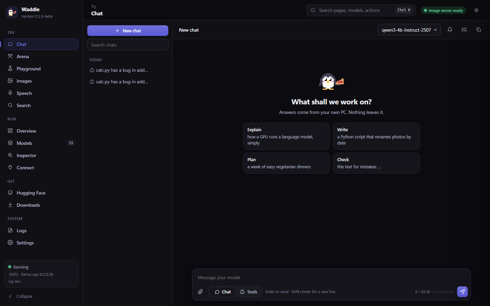
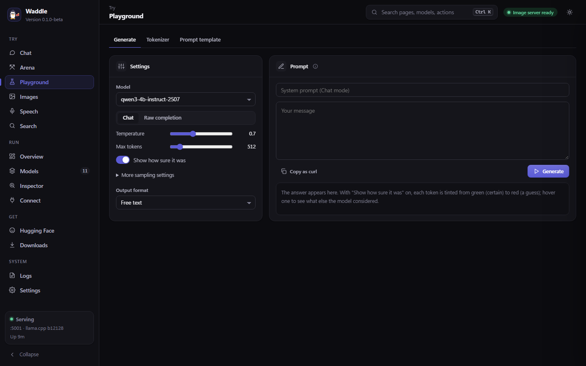
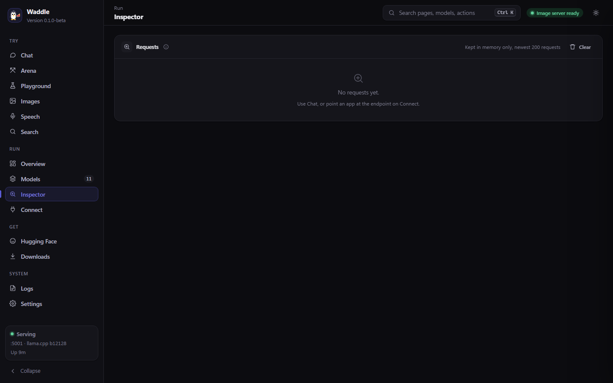
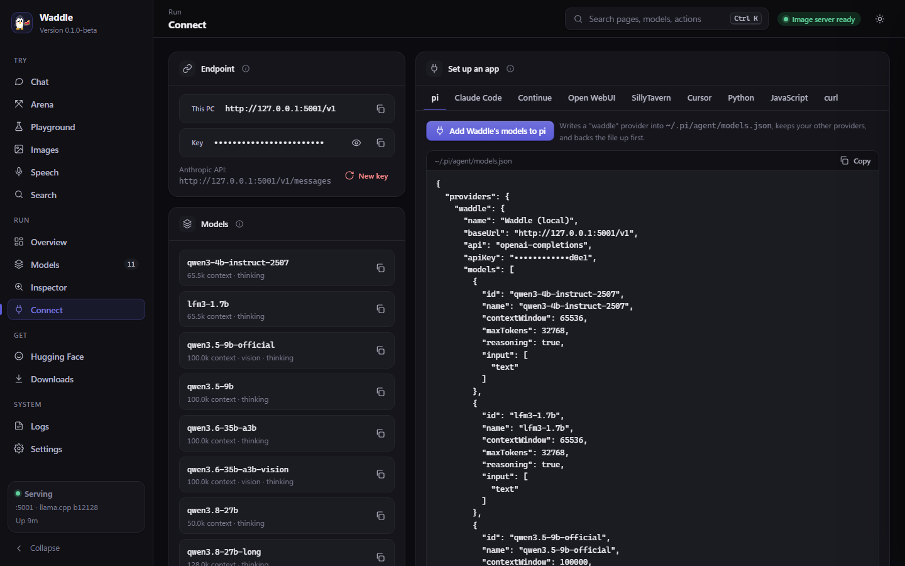

<p align="center">
  
</p>

<h1 align="center">Waddle</h1>

<p align="center">
  <b>The local AI sandbox.</b><br>
  Find a model, try it every way, see how it runs on your PC, then keep it running for every app you use.<br>
  One small program. Your data never leaves your computer.
</p>

<p align="center">
  <a href="https://github.com/soleritu/waddle/releases"></a>
  
  
  <a href="LICENSE"></a>
</p>

<p align="center"></p>

> **Beta.** 0.1 is the first public release. It works well on the machines it was built on; tell us what breaks on yours.

## Install

**Windows** (no administrator rights needed), in PowerShell:

```powershell
irm https://raw.githubusercontent.com/soleritu/waddle/main/install.ps1 | iex
```

**Linux:**

```bash
curl -fsSL https://raw.githubusercontent.com/soleritu/waddle/main/install.sh | sh
```

Or download `Waddle-Setup.exe` or `Waddle-x86_64.AppImage` from [Releases](https://github.com/soleritu/waddle/releases).

The first time, Waddle sets itself up: it looks at your graphics card, installs the right build of llama.cpp, takes in models you already have from Ollama, LM Studio, or the Hugging Face cache, and suggests a first model that fits.

## What it does

### Try

| | |
|---|---|
| **Chat** with any model: answers stream in, thinking folds away, and you can attach text, code, and images. **Tools** mode lets a model work in a folder (read, search, edit, run commands, use MCP servers) with every step on a live timeline and each change waiting for your approval. |  |
| **Arena:** two to four models answer the same prompt side by side, blind if you like, and your votes build a leaderboard. One click compares two quantizations of the same model. |  |
| **Playground:** every sampling setting, raw completion without a chat template, how sure the model was of each token, JSON schema and grammar output, a tokenizer, the exact prompt the model sees, and Copy as curl. |  |
| **Images:** any size up to 8192 px, with steps, guidance, seed, sampler, and negative prompt; several at once; image-to-image; and upscaling. Plus **Speech** (speech to text and text to speech) and **Search** (embeddings and reranking over your own files). |  |

### Run

| | |
|---|---|
| **Your models, served** at `http://127.0.0.1:5001/v1`, OpenAI-compatible, and Anthropic-compatible at `/v1/messages`. One model at a time, loaded when an app asks, unloaded when idle. |  |
| **Every model's settings,** with presets such as `qwen:long`, draft models, LoRA adapters, vision and MTP switches, and the authors' recommended sampling. **Tune** finds the fastest settings that fit your GPU and measures them; **Quality check** runs 24 quick tasks. Results keep their history per llama.cpp build. |  |
| **Inspector:** the exact request and answer for every call any app makes, with tokens and timing. **Overview:** CPU, RAM, GPU, VRAM and spill, tokens per second, and every AI process on the PC, including other apps such as Ollama, with an End button. |  |
| **Connect** gives ready settings for [pi](https://pi.dev) (one click), Claude Code, Continue, Open WebUI, SillyTavern, Cursor, Python, JavaScript, and curl. |  |

### Get

**Hugging Face, every way:** text, vision, audio, embedding, reranker, speech, image, upscaler, and LoRA models. Sort by trending, downloads, likes, or date; filter by size, context, fit, tool calls, thinking, mixture of experts, license, architecture, language, and any tag. Each model shows every file, the best size for your GPU, and its projector and MTP draft head. Downloads resume, are checked against Hugging Face's SHA-256, and start with a context that fits your GPU.

<p align="center"></p>

**Models you already have** in Ollama, LM Studio, the Hugging Face cache, or any folder are taken in without copying, with the settings other apps worked out for them.

## Use it from other tools

Waddle is the runner; agents and editors connect to it. Open **Connect** for copy-ready settings. For example, with [pi](https://pi.dev):

1. Open Waddle › Connect › pi and press **Add Waddle's models to pi**.
2. In pi, pick a model with `/model`.

Any OpenAI-compatible client works with the address and key on that page.

## How it works

Waddle is one Rust program with its dashboard built in. It runs [llama.cpp](https://github.com/ggml-org/llama.cpp)'s router for text models, [stable-diffusion.cpp](https://github.com/leejet/stable-diffusion.cpp) for pictures, and llama.cpp's `llama-tts` for speech, and downloads the right builds for your hardware. Apps reach models through Waddle's gateway, which checks the key and shows each request in the Inspector; llama.cpp itself only listens on your PC.

- Read the **[guide](docs/GUIDE.md)** for every page and setting.
- **[Design notes](docs/DESIGN.md)** explain the choices.
- **[Security](SECURITY.md)** says what's protected, and what isn't.

## Build from source

```bash
cargo build --release      # the program, in target/release
cargo test                 # 27 tests, using temporary folders only
```

On Windows, `iscc packaging\windows\waddle.iss` builds the installer; on Linux, `packaging/linux/build-appimage.sh` builds the AppImage. Pushing a version tag such as `v0.1.0-beta` builds both on GitHub.

Put `waddle.exe` in a folder with an empty file named `portable` to keep everything in that folder.

## Roadmap

- Packaged NVIDIA (CUDA) builds tested on real hardware
- A model card summary and "similar models" in the Hugging Face panel
- Sharing an Arena leaderboard
- German translation

## License

MIT. The penguin is Waddle's own.
