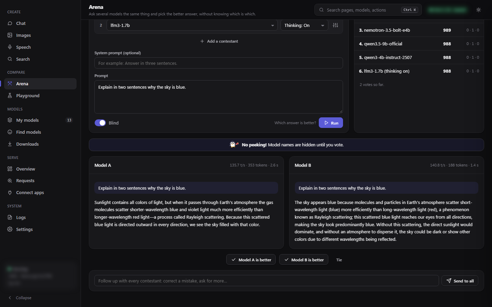
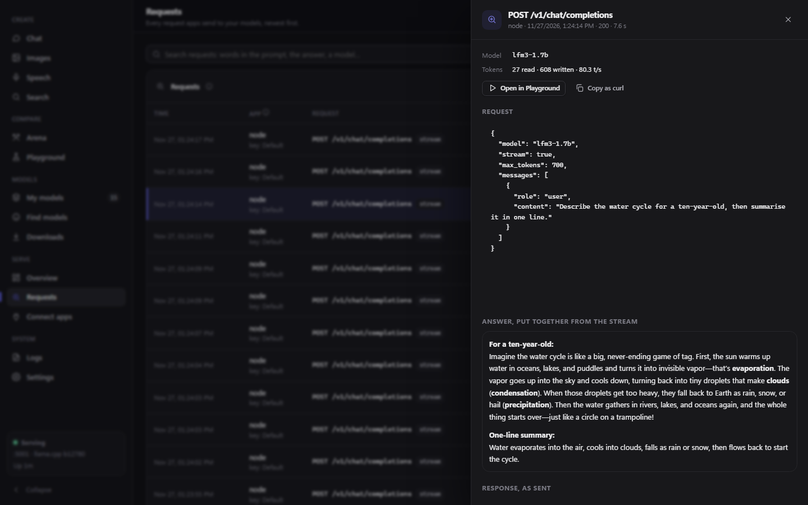
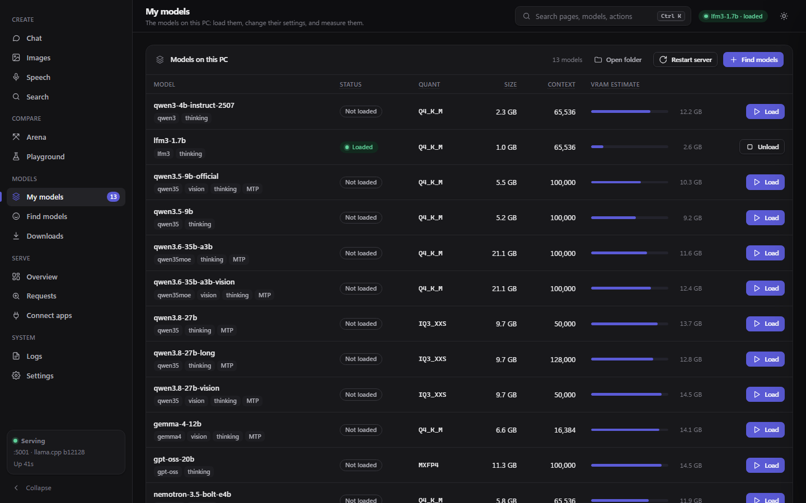
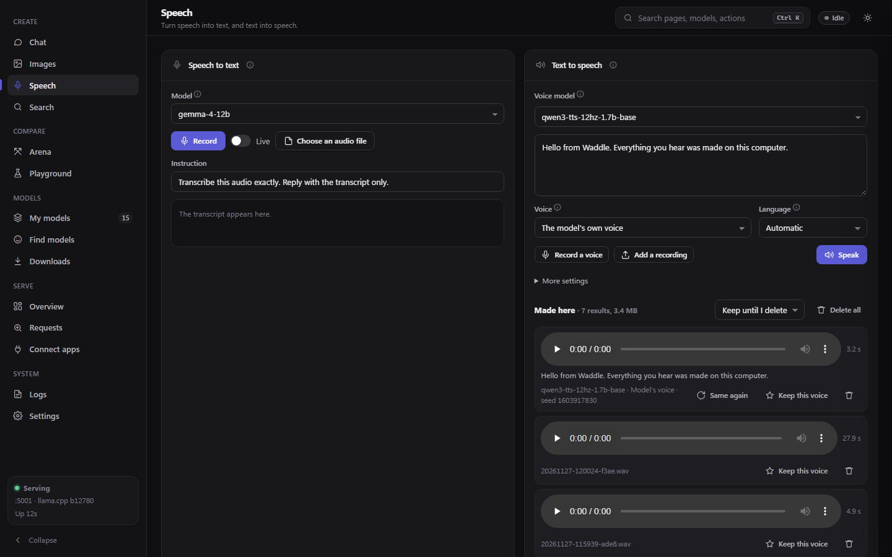
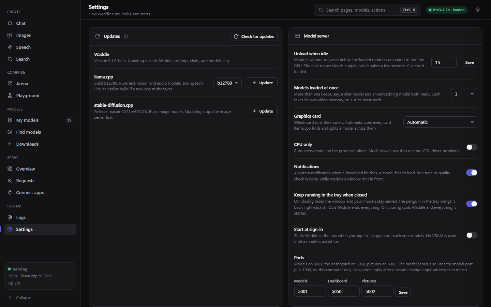
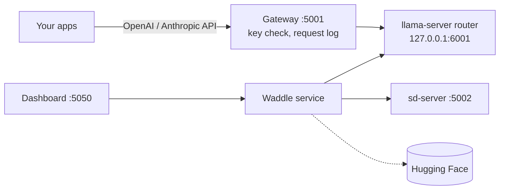

<p align="center">
  
</p>

<h1 align="center">Waddle</h1>

<p align="center">
  <b>Local AI sandbox and model server in one small Rust program.</b><br>
  Find GGUF models, try and compare them, tune them for your GPU, and serve them to any app through an OpenAI- and Anthropic-compatible endpoint.
</p>

<p align="center">
  <a href="https://github.com/soleritu/waddle/releases"></a>
  <a href="https://github.com/soleritu/waddle/actions/workflows/ci.yml"></a>
  
  <a href="LICENSE"></a>
</p>

<p align="center">
  <a href="#download">Download</a> ·
  <a href="#showcase">Showcase</a> ·
  <a href="#quick-start">Quick start</a> ·
  <a href="docs/GUIDE.md">Guide</a> ·
  <a href="docs/API.md">API</a> ·
  <a href="docs/CONFIGURATION.md">Configuration</a> ·
  <a href="docs/ARCHITECTURE.md">Architecture</a> ·
  <a href="CONTRIBUTING.md">Contributing</a>
</p>


<p align="center"><sub>Overview during real load: lfm3-1.7b answering four requests at once on an AMD RX 9060 XT. At the top, what needs your attention, each with its fix.</sub></p>

> [!WARNING]
> **Beta software (0.1).** Expect bugs, rough edges, and changes between versions, including to settings files. It comes with no warranty (see the [license](LICENSE)). Keep backups of anything you can't lose, and report problems in [issues](https://github.com/soleritu/waddle/issues).

## What it is

- **Built on [llama.cpp](https://github.com/ggml-org/llama.cpp) and [stable-diffusion.cpp](https://github.com/leejet/stable-diffusion.cpp).** llama-server's router loads whichever model a request names. Waddle adds the dashboard, defaults, and glue.
- **One endpoint for all apps:** `http://127.0.0.1:5001/v1` (OpenAI) and `/v1/messages` (Anthropic).
- **Every request visible:** the exact JSON each app sends and gets back, kept in memory or, if you choose, on disk.
- **It tells you what's wrong:** a missing engine or file, a model too big for your card, a model that can't see or speak yet, little disk space. Each comes with a button that fixes it.
- **Small and native:** about 10 MB, its own window and tray icon, no Electron, Python, or Node. GPU libraries aren't bundled; the first run downloads the llama.cpp build for your hardware (CUDA, Vulkan, Metal, or CPU).

## Download

| System | Get it | Terminal |
|---|---|---|
| Windows 10/11 x64 | [`Waddle-Setup.exe`](https://github.com/soleritu/waddle/releases) | `irm https://raw.githubusercontent.com/soleritu/waddle/main/install.ps1 \| iex` |
| macOS 12+ (Apple Silicon, Intel) | [`Waddle-macOS.zip`](https://github.com/soleritu/waddle/releases) | `curl -fsSL https://raw.githubusercontent.com/soleritu/waddle/main/install.sh \| sh` |
| Linux x86-64 | [`Waddle-x86_64.AppImage`](https://github.com/soleritu/waddle/releases) | `curl -fsSL https://raw.githubusercontent.com/soleritu/waddle/main/install.sh \| sh` |
| Docker | [`ghcr.io/soleritu/waddle`](docs/GUIDE.md#docker) | `docker run -d -p 5050:5050 -p 5001:5001 -v waddle:/data ghcr.io/soleritu/waddle` |

Standalone binaries are on the release page: `waddle-windows-x64.exe`, `waddle-macos`, `waddle-linux-x64`. The apps aren't signed with paid certificates: on macOS right-click › **Open** the first time; on Windows SmartScreen choose **More info › Run anyway**.

### Docker Compose

Save this as `compose.yaml` (also in [`packaging/docker/compose.yaml`](packaging/docker/compose.yaml)), then run `docker compose up -d` and `docker compose logs waddle` for the sign-in link.

```yaml
services:
  waddle:
    image: ghcr.io/soleritu/waddle:latest   # :vulkan for AMD and Intel GPUs
    ports:
      - "5050:5050"   # dashboard
      - "5001:5001"   # your models (OpenAI and Anthropic API)
      - "5002:5002"   # image server
    volumes:
      - waddle:/data  # models, chats, pictures, settings
    restart: unless-stopped
    # NVIDIA (needs the NVIDIA Container Toolkit):
    # deploy:
    #   resources:
    #     reservations:
    #       devices: [{driver: nvidia, count: all, capabilities: [gpu]}]
    # AMD and Intel, with :vulkan:
    # devices: ["/dev/dri:/dev/dri"]
volumes:
  waddle:
```

## Showcase

Screenshots from a running Waddle with real models.

**Arena:** contestants with their own settings (thinking on or off, sampling, context) answer the same prompt blind. Follow up with all of them, vote, and open any answer in Chat to keep going.



**Requests:** the request and response of every call, with app, key, model, tokens, and speed; searchable, exportable, and one click from the Playground.



**Chat:** streaming, folded thinking, attachments, answers from your own documents or the web with sources, dictation and read-aloud, editing, continuing and comparing answers, and a Tools mode for testing tool use with undo.


**Connect apps:** address, a key per app, and ready settings for pi, Claude Code, Continue, OpenCode, Aider, Zed, VS Code, Open WebUI, LibreChat, Jan, SillyTavern, Cursor, Python, JavaScript, and curl, for the models you tick. pi and Continue are set up in one click.


**Playground:** every sampling option, raw completion, JSON and grammar output, A/B runs, saved sessions, and each token coloured by the model's confidence.


**Find models:** Hugging Face by kind, sortable and filterable, with a table of what fits your GPU (mixture-of-experts models included, with their experts in system RAM) and picks taken from the results. Models you add from elsewhere are matched to their Hugging Face page.


**Images:** text-to-image, image-to-image and inpainting with stable-diffusion.cpp, LoRAs, upscaling, a queue, seeds, favourites, and saved setups.


**Speech:** speech to text with models that hear, and text to speech with llama-tts: record or add a voice to copy, keep a voice you like, pick the language, speed, and pitch.

<details><summary>More: My models, model settings, Speech, Settings</summary>







</details>

## Quick start

1. Open Waddle. Setup installs llama.cpp for your GPU and suggests models that fit.
2. Copy the key from **Connect apps**.
3. Call it:

```bash
curl http://127.0.0.1:5001/v1/chat/completions \
  -H "Authorization: Bearer $WADDLE_KEY" -H "Content-Type: application/json" \
  -d '{"model": "qwen3-4b", "messages": [{"role": "user", "content": "Hello!"}]}'
```

`model` is the model's name in Waddle. `GET /v1/models` lists them. See [docs/API.md](docs/API.md).

## How it works



All ports listen on `127.0.0.1` (this computer only) unless you turn on **Settings › Network access**. Details: [docs/ARCHITECTURE.md](docs/ARCHITECTURE.md).

## Build

```bash
cargo run                                      # app with window
cargo build --release --no-default-features    # headless, as in Docker
cargo test
cd tests/ui && npm ci && npm test              # every page in jsdom
```

Linux needs `libwebkit2gtk-4.1-dev`, `libayatana-appindicator3-dev`, `libxdo-dev` for the window. See [CONTRIBUTING.md](CONTRIBUTING.md).

## License

[GNU AGPL 3.0](LICENSE). You can use, change, and share Waddle, including commercially. If you distribute it, or run a changed version as a service for others over a network, you must publish your source under the same license. llama.cpp and stable-diffusion.cpp are MIT-licensed and downloaded from their own releases.
