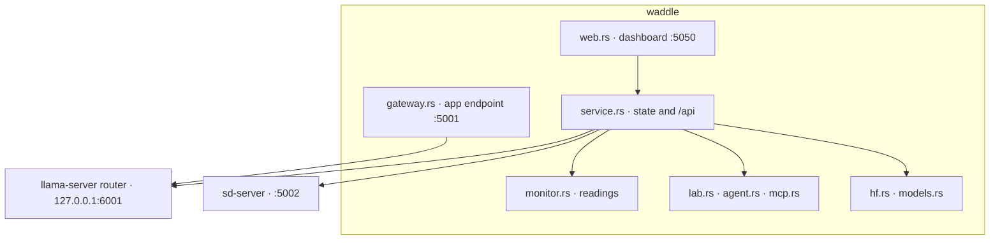

# Architecture

One Rust process plus the engines it downloads. Rules for changes are in [AGENTS.md](../AGENTS.md).



## Ports

| Port | Process | Access |
|---|---|---|
| 5001 | Gateway | API key. `127.0.0.1`, or the network when sharing is on. |
| 5002 | sd-server | No key. `127.0.0.1`, or the network when sharing is on. |
| 5050 | Dashboard | Dashboard key, Host and Origin checks. `127.0.0.1`; the network in Docker. |
| 6001 | llama-server | Private key. Always `127.0.0.1`. |

## Startup (`main.rs`)

1. Resolve the data folder.
2. Single instance: a second launch shows the first window and exits.
3. `config::migrate_ini` brings `ai.ini` to the current format.
4. Start the dashboard, gateway, and router.
5. Open the window (`window` feature) or print a sign-in link (browser version).

## Gateway (`gateway.rs`)

Checks the key, forwards to `127.0.0.1:6001` with the router's key, streams the reply unchanged, and keeps the last 200 requests (bodies up to 256 KB) in memory. Refused requests are logged too.

## Router (`llama.rs`)

```text
llama-server --host 127.0.0.1 --port 6001 --api-key-file logs/router-key.txt
             --models-preset logs/router.ini --models-max 1 --metrics [--sleep-idle-seconds N]
```

`router.ini` is `ai.ini` without Waddle's own keys and with presets resolved. Install picks the newest llama.cpp release that has builds, and the archive for the system and GPU: CUDA (plus runtime) for NVIDIA, Vulkan for AMD and Intel, Metal on macOS, else CPU. Each build gets its own `llama-b<build>/` folder.

## Readings (`monitor.rs`)

Each second: slots and throughput from llama-server's `/slots` and `/metrics`; GPU and VRAM from nvidia-smi, Windows performance counters, or Linux sysfs (macOS reports unified memory); CPU and RAM from the system. Processes are marked as Waddle's or another app's.

## Dashboard (`page.html`, `web.rs`, `service.rs`)

One HTML file embedded with `include_str!`, no framework or build step. Each page is a `VIEWS` entry with `shell()` (render once), `update()` (each status tick), and `once()`. It calls `POST /api/<name>`, dispatched in `service.rs`. `web.rs` requires the key (sign-in link sets an HttpOnly SameSite=Strict cookie), a local Host, and same Origin.

## Images (`images.rs`, `service.rs`)

Each stable-diffusion.cpp release goes in its own `sd-<release>/` folder, so an update never overwrites files in use. `sd-server` starts on demand with `[image]` options. Pictures use `/sdapi/v1/txt2img` and `img2img`; progress is read from `image.log`. Each PNG has a `.json` beside it with its settings. Text and image models take turns on the GPU.

## Web search (`tools.rs`)

Off by default. With DuckDuckGo (HTML results, no key) or Brave (Search API, key), Tools mode gets a `web_search` tool and Chat can search before it asks, sending the results with the message.

## Design choices

- Sandbox and runner, not an agent harness; tools mode only tests tool use.
- Use llama.cpp for anything it already does.
- No bundled GPU libraries; download the build each machine needs.
- Requests log in memory only.
- One model loaded at a time.
- Model output rendered as text nodes, never HTML.
- Sizes in rem, scaled with the window.
- Standard formats: OpenAI and Anthropic APIs, `mcp.json`, llama-server options in `ai.ini`.

## Tests

- `cargo test`: server logic against a temp folder and `FakeNet` (no real network or files).
- `tests/ui`: every page in jsdom with fake answers; fails on any script error.
- `npm run shots` in `tests/ui`: screenshots of a running Waddle via headless Chrome.

CI runs both on Windows, macOS, and Linux, builds the headless variant, and smoke-tests Docker. A version tag builds every download.
